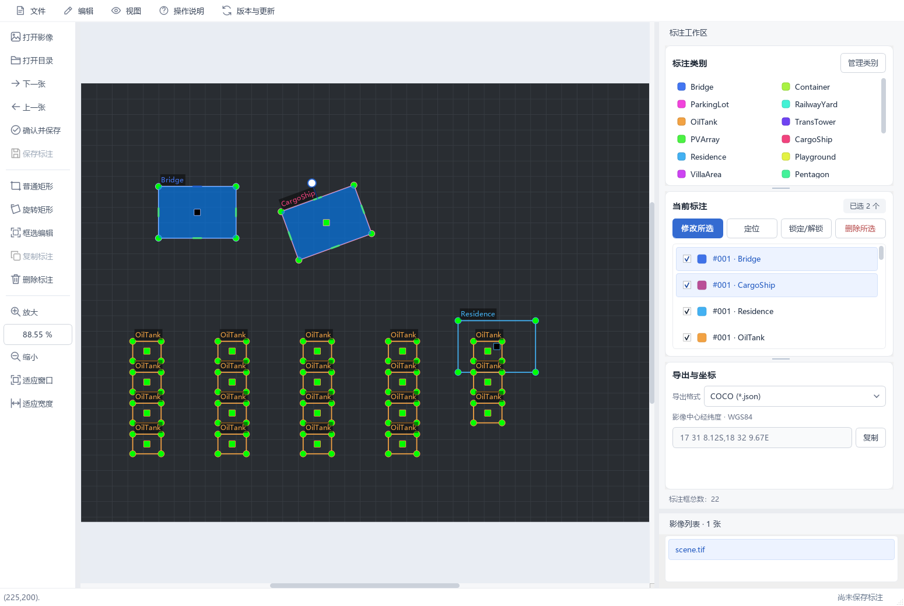

# 2.0.2 单边调整与大量标注性能优化

本轮修改本地源码，版本保持 2.0.2，尚未重新构建或上传安装包。

## 单边调整

鼠标移到普通框或旋转框的一条边中段，出现调整大小的光标后按住左键拖动。
该边的两个端点沿垂直于边的方向移动，对边固定，旋转角度不变。
选中或悬停时显示四条边的短线手柄，当前边高亮；命中范围按屏幕像素保持，不随影像比例缩小。
很小的框保留角点操作，避免角点和边的命中区域互相干扰。

连续绘制时也可调整已有框；锁定框需先解锁。调整会防止跨过对边、变为零面积及超出允许的影像范围。
一整次拖动对应一次撤销记录，支持 Ctrl+Z / Ctrl+Y。四角调整、圆形手柄旋转和右键双击改标签继续保留。

## 优化内容

- 使用分块空间索引，鼠标只对附近候选框做角点、边与内部命中检测。
- 几何和标注列表发生变化时自动刷新索引，保持层次顺序，避免移动、旋转、增删、重载和撤销后残留旧位置。
- 缓存路径、外接矩形、顶点绘制路径和类别文字所在的边，避免重复构建相同几何。
- 根据 Qt 的绘制区域查询标注，跳过视口及刷新区域之外的框；类别文字和旋转手柄使用保守边距防止被裁掉。
- 悬停目标不变时不重复绘制；拖动、新框预览和悬停变化采用局部刷新，并由 Qt 合并刷新请求。
- 几何调整不再重新统计全图类别编号、更新所有列表条目，保存状态样式仅在状态发生变化时更新。
- 光标在画布自身设置，避免鼠标移动时反复修改整个应用的光标栈。

## 合成场景测量

Windows，Python 3.12，PyQt5 / Qt 5.15，offscreen 渲染；10,000 个分散框，间隔 120 像素，框大小 40×30，比例 100%。
比较同一份 Shape 实现上的全量遍历和索引/裁剪策略，使用重复测量的中位数。
基准代码见 `tools/benchmark_annotations.py`，测量数据见 `annotation-benchmark-2.0.2.json`。

| 单项计算 | 全量遍历 | 索引或裁剪 |
| --- | ---: | ---: |
| 鼠标命中检测 | 92.821 毫秒 | 0.035 毫秒 |
| 1024×768 视口的标注绘制 | 341.713 毫秒 | 4.283 毫秒 |

首次建立 10,000 个框的索引用时 109.533 毫秒。示例鼠标位置只有 1 个候选框；视口及文字边距中有 80 个候选框。
这些结果仅衡量查找与标注绘制，**不是整个软件的响应时间，不包含 TIFF 读取、列表构建或首次撤销快照**。
框大量重叠在同一区域、缩小后全部可见、硬件及影像不同，效果会不同；数据和导出标注不会因裁剪而减少。

在项目的 Python 环境中执行 `python tools/benchmark_annotations.py` 可重新测量，结果写入 `build/annotation-benchmark.json`。
自动化测试使用候选数量及正确性检查，而非硬件相关的耗时阈值。
