# 2.0.2 界面调整预览

版本保持 2.0.2。按照用户最新要求，2026-10-12 已使用当前源码重新构建 EXE，位置为 `dist/roLabelImg/roLabelImg.exe`，打包自检通过。
本次尚未构建 Setup 或绿色版，也未上传、发布 GitHub；`release` 中已有的 2.0.2 安装包仍是此前构建。后续命令见 `RELEASE_2.0.2_COMMANDS.md`。

## 调整内容

- 使用中性灰文字、浅灰背景、白色分组面板，统一边框、字号、间距与圆角。
- 右侧分为类别、当前标注、导出与坐标，区域之间可上下拖动调整高度；影像列表高度也可调整。
- 英文类别最多两列，颜色使用小色块；选中状态使用浅蓝色背景，保留再次点击取消。
- 下拉框使用平面边框和细线箭头；主要操作使用蓝色按钮，其余按钮保持中性。
- 批量编辑窗口重新安排标题、数量、输入项和说明，取消按钮中文化，移除标题栏问号。
- 标注列表、总数、影像列表和工具栏使用一致的视觉样式。
- 下拉选项使用独立绘制的宽松行距、类别色块、悬停和当前项标记；预览包含实际展开的列表。
- 菜单名称与快捷键按两列绘制，修复长中文菜单项重叠，并验证较大字号及鼠标点击。
- 版本设置窗口增加统一的标题、设置区和操作栏，检查中、无更新和网络失败的状态直接显示在窗口中。
- 类别管理、操作说明、大图巡检和下载窗口统一弹窗样式，关闭与取消按钮使用中文。
- 版本窗口增加“已发现新版本”区域，可在限流或检查失败后查看缓存日志并更新；重启后仍保留，已校验安装包可离线复用。
- 右键双击一个标注框，在统一样式的类别弹窗中修改单个框的标签，支持连续绘制与撤销、重做。
- 修复未打开影像时 Ctrl＋滚轮退出；左侧工具栏宽度可调整，收窄只显示图标，布局自动保存；顶部导航同时显示细线图标与文字。
- 增加四条边中段的单边调整，并优化大量标注的命中检测、几何缓存、局部绘制及列表更新；详见 `ANNOTATION_PERFORMANCE_2.0.2.md`。
- 修正左右区域尺寸：右侧固定操作行保持顶部对齐，只有列表和底部留白变高；左侧上限仅容纳完整图标与文字，避免多余空白条。

## 源码界面截图

截图通过当前源码运行窗口生成，使用示例影像和示例标注，不代表用户真实影像。更新窗口中的版本和下载进度为演示数据。

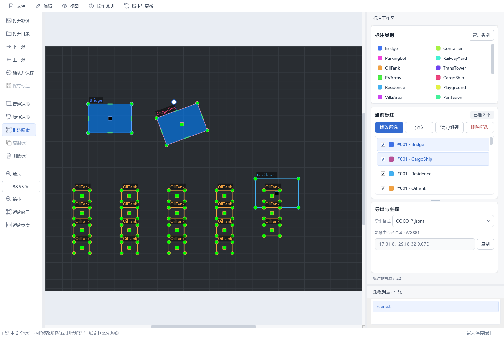

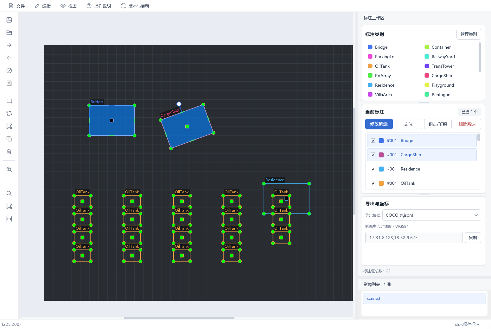

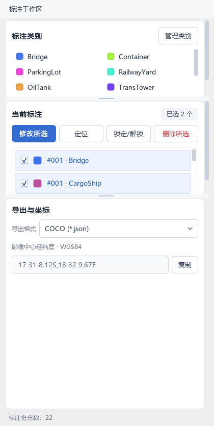

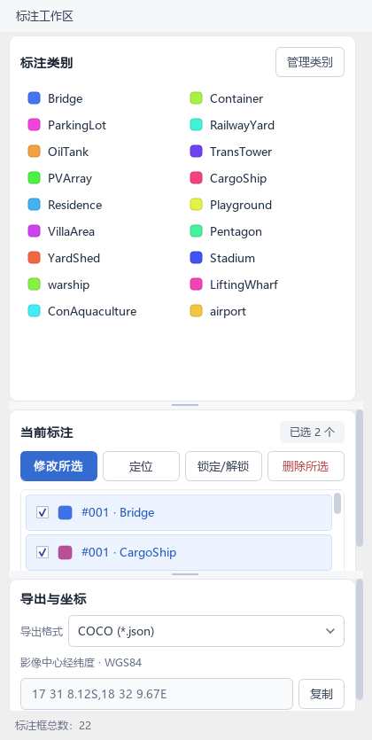

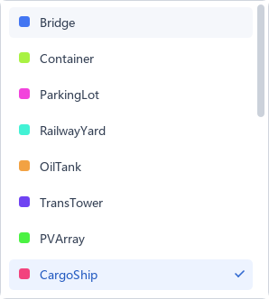

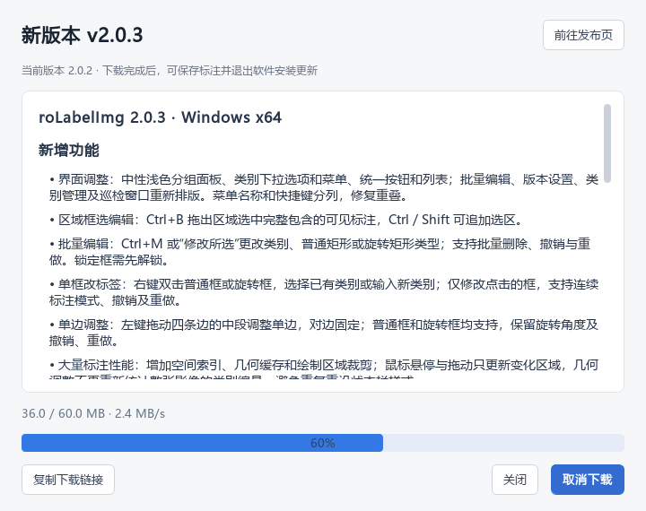

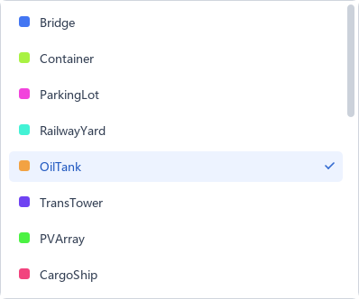

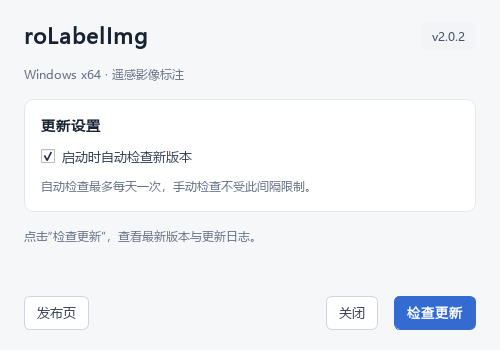

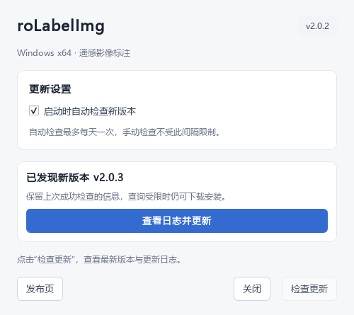

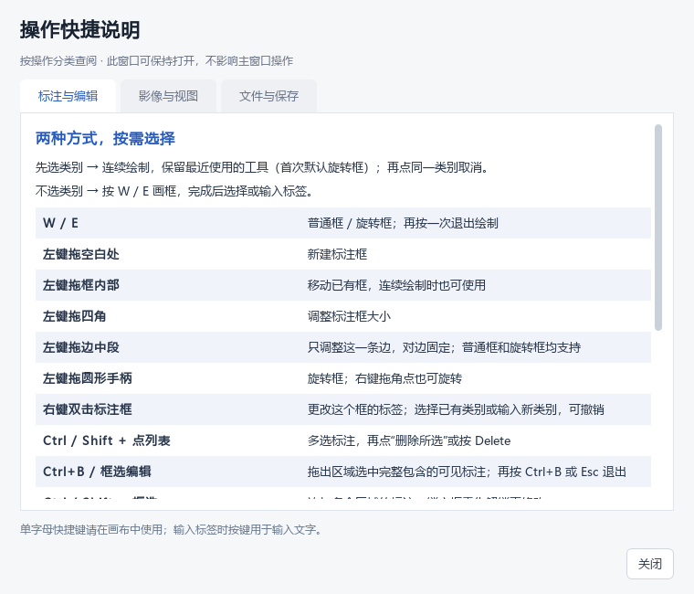

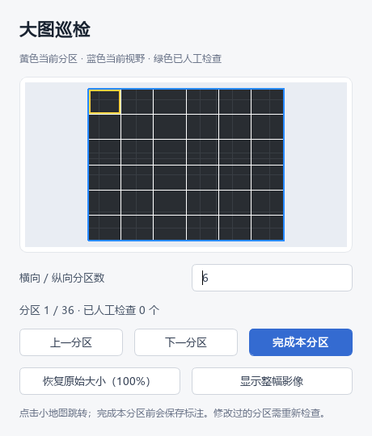

## 验证

229 项回归测试通过，包括固定操作行位置、内容区伸缩、不同字号的工具栏宽度上限、旧布局恢复、单边调整、大量标注命中和绘制、保存及版本更新。已经检查实际展开的列表和菜单，以及主要弹窗预览。当前源码 EXE 的打包自检结果为 `ok: true`、版本 `2.0.2`；自检验证依赖和读写功能，人工安装及升级验收仍需在生成新 Setup 后进行。
